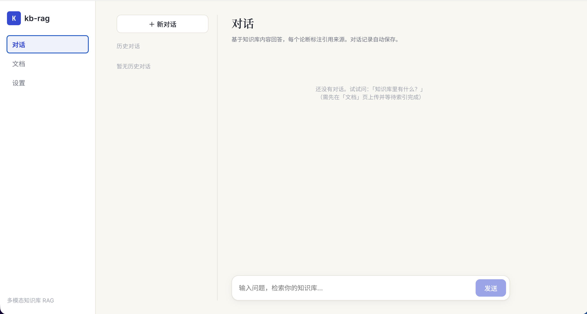
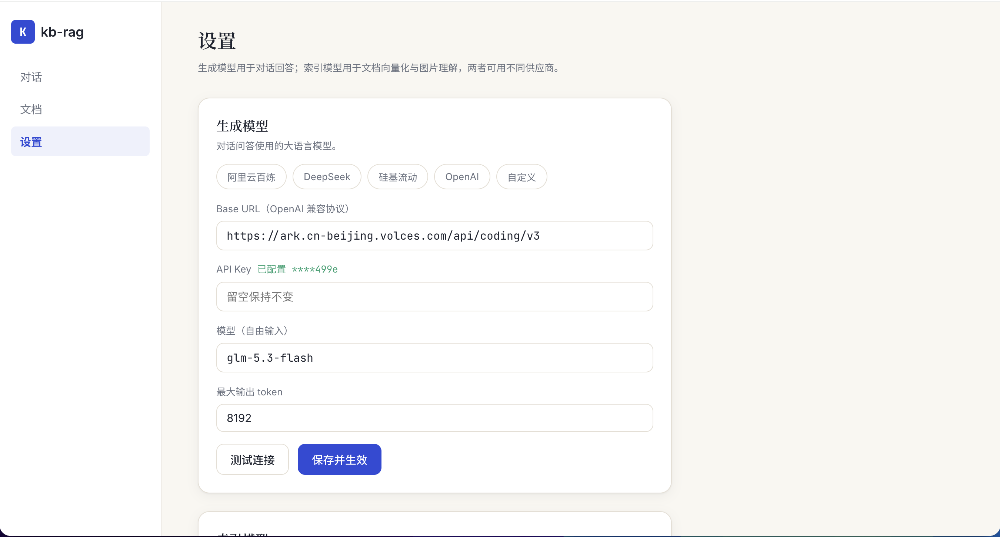
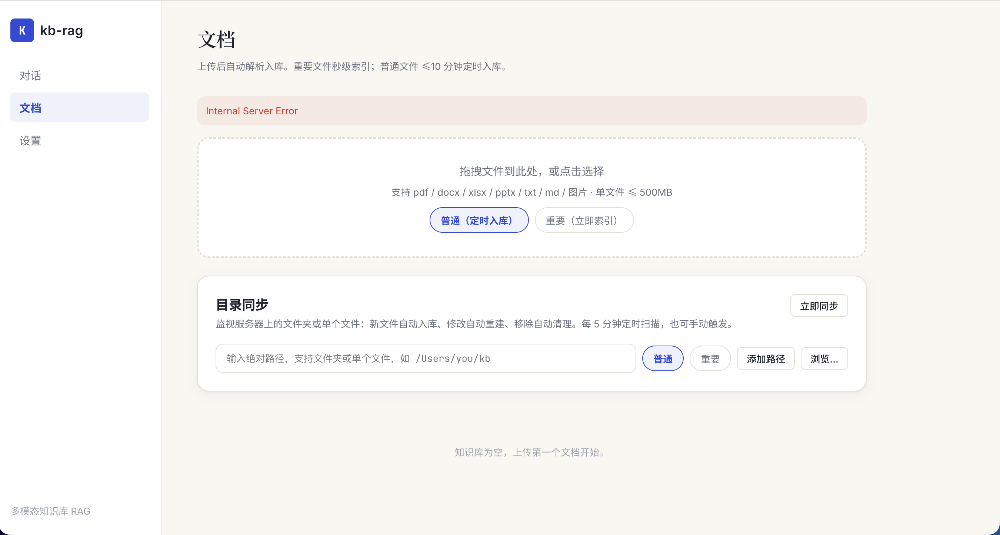

# kb-rag 多模态知识库系统

多模态 RAG：PDF/Word/xlsx/PPT/图片/视频入库 → 混合检索（向量+BM25+RRF+Rerank）→ 云端 LLM 带引用回答。完整方案见 [IMPLEMENTATION_PLAN.md](IMPLEMENTATION_PLAN.md)。

## 界面预览

**对话** —— 基于知识库回答，每个论断标注引用来源，可点击溯源，对话记录自动保存：



**文档** —— 拖拽上传自动入库，目录同步监视本地文件夹或单个文件：



**设置** —— 生成模型与索引模型分组配置，支持百炼 / DeepSeek / 硅基流动 / OpenAI / 自定义：



## 功能特性

- **多模态入库**：pdf / docx / xlsx / pptx / txt / md / 图片 / 视频，解析 → 分块 → 向量化 → 双路索引
- **混合检索**：向量（Qdrant）+ BM25（PG tsvector）双路召回 → RRF 融合 → 云端 Rerank
- **引用溯源**：回答中 [1][2] 编号与 chunk 级元数据（页码 / 页面 / 时间戳）一一对应，弹窗查看原文
- **目录同步**：监视文件夹或单个文件，新文件自动入库、修改自动重建、移除自动清理；支持原生选择窗口（浏览…），重要文件立即索引、普通文件 ≤10 分钟定时入库
- **检索降级**：向量检索不可用时自动退纯本地 BM25，再不可用则无引用直答——检索故障不阻断对话
- **错误透传**：模型 API 的鉴权、限流、参数错误以明确文案直达聊天气泡，不再笼统的 network error
- **MCP 接入**：暴露 `kb_search` 等工具给 Claude Code，知识库即插即用

## 快速启动

```bash
# 1. 基础设施（PG / Qdrant / Redis / MinIO）
docker compose up -d

# 2. 后端依赖与数据库
uv venv && uv pip install fastapi "uvicorn[standard]" pydantic pydantic-settings \
  "sqlalchemy[asyncio]" asyncpg psycopg2-binary alembic httpx qdrant-client redis arq \
  minio python-magic structlog cryptography pymupdf python-docx openpyxl python-pptx \
  watchdog "apscheduler<4.0" mcp sse-starlette pytest pytest-asyncio ruff
cp .env.example .env          # 按需修改
.venv/bin/alembic upgrade head

# 3. 前端
cd web && pnpm install && pnpm build && cd ..

# 4. 启动（两个终端）
.venv/bin/uvicorn app.main:app --port 8000          # API + 前端 http://localhost:8000
.venv/bin/arq app.workers.worker.WorkerSettings     # 索引 worker
```

## 使用

1. 打开 http://localhost:8000 → 设置页：分别配置**生成模型**（对话回答）与**索引模型**（向量化 / 图片理解），各填 Base URL + API Key + 模型 → 测试连接 → 保存生效
2. 文档页：拖拽上传（重要 = 立即索引，普通 = ≤10 分钟定时入库）；或添加目录同步路径（支持文件夹 / 单个文件，可点击「浏览…」用系统选择窗口选取）
3. 对话页：提问，答案带 [1][2] 引用可点击溯源；对话记录自动保存

> 注意：生成模型与索引模型可以使用不同服务商。索引侧的向量化需要服务商提供 embedding 接口（如阿里百炼 text-embedding-v3）；更换 embedding 模型后已有向量需重建索引。

## Claude Code 接入（MCP）

```bash
claude mcp add kb-rag --transport http http://localhost:8000/mcp
```

暴露工具：`kb_search` / `kb_get_document` / `kb_list_documents` / `kb_task_status`

## 测试

```bash
.venv/bin/python -m pytest tests/ -q
```
